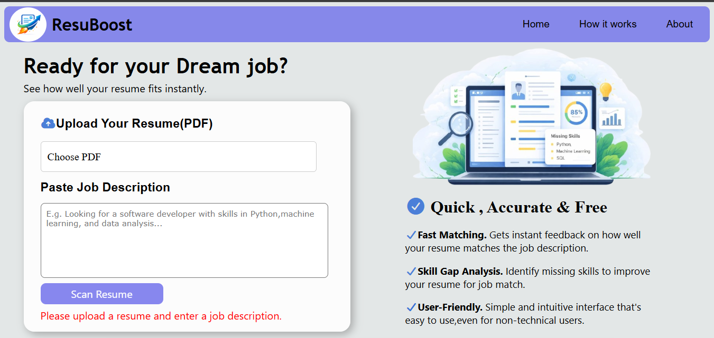

# ResuBoost AI – Resume Scanner

**Live Demo:** [Try ResuBoost AI](https://resuboostai.onrender.com)

ResuBoost AI is an AI-powered resume analyzer that evaluates resumes against job descriptions, identifies relevant and missing skills, and provides actionable suggestions to improve resume alignment with target roles.

## Application Preview



## Features

- **Resume Scoring:** Evaluate a resume against a given job description.
- **Skill Extraction:** Identify relevant skills mentioned in the resume.
- **Missing Skill Detection:** Highlight skills and keywords missing in relation to the job description.
- **Improvement Suggestions:** Provide recommendations to improve resume alignment.
- **Learning Guidance:** Suggest areas and skills to focus on for career development.
- **Responsive Interface:** Designed to work across different screen sizes.

## Tech Stack

| Layer | Technologies |
|---|---|
| Backend | Python, Flask |
| Frontend | HTML, CSS, JavaScript |
| NLP | spaCy |
| Text Similarity | Scikit-learn, TF-IDF |
| PDF Processing | PDFPlumber |
| Deployment | Render |

## Running Locally

### Prerequisites

- Python
- pip

### 1. Clone the repository

```bash
git clone https://github.com/keerthi-siddigari/AI_ResumeScanner.git
cd AI_ResumeScanner
```

### 2. Create and activate a virtual environment

```bash
python -m venv venv
```

**Windows**
```bash
venv\Scripts\activate
```

**macOS/Linux**
```bash
source venv/bin/activate
```

### 3. Install dependencies

```bash
pip install -r requirements.txt
```

### 4. Run the application

```bash
python app.py
```

Open the local URL displayed by Flask in your terminal.

## Project Highlights

- Built a full-stack resume analysis application using Flask and JavaScript.
- Applied NLP techniques to extract and process resume information.
- Used TF-IDF similarity to compare resumes against job descriptions.
- Generated skill-gap insights and actionable improvement suggestions.
